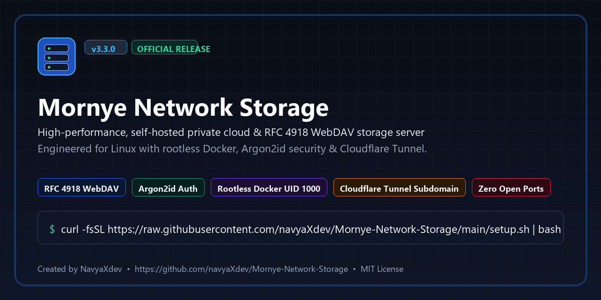

<div align="center">



# Mornye Network Storage

### High-Performance Self-Hosted Private Cloud & RFC 4918 WebDAV Server for Linux

[](https://navyaxdev.github.io/Mornye-Network-Storage/)
[](https://github.com/navyaXdev/Mornye-Network-Storage/releases)
[](LICENSE)
[](https://github.com/navyaXdev/Mornye-Network-Storage/actions)
[](https://www.python.org/)
[](compose.yaml)
[](webdav/)
[](SECURITY.md)
[](docs/CLOUDFLARE_TUNNEL.md)

[**Website**](https://navyaxdev.github.io/Mornye-Network-Storage/) • [**Documentation**](docs/README.md) • [**Installation Guide**](docs/INSTALLATION.md) • [**Guides & Tutorials**](https://navyaxdev.github.io/Mornye-Network-Storage/guides/) • [**Changelog**](CHANGELOG.md) • [**Security**](SECURITY.md)

</div>

---

## 1. What is Mornye Network Storage?

**Mornye Network Storage** is an open-source, self-hosted network storage system and RFC 4918 WebDAV server engineered specifically for modern Linux distributions. Created by [**NavyaXdev**](https://github.com/navyaXdev), it delivers a hardened, lightweight private cloud storage platform designed for seamless multi-client access, rootless container security, and zero-port-forward remote accessibility via Cloudflare Tunnels.

Whether deployed as a dedicated home network-attached storage (NAS) server, a self-hosted personal music streaming backend, or an encrypted developer file repository, Mornye eliminates bloated web UI dependencies in favor of a lean, high-throughput POSIX architecture.

### Key Highlights
- **Universal Linux Compatibility**: Native automated setup for Debian, Ubuntu, Kali Linux, Arch, Fedora, openSUSE, and Alpine across `x86_64` and `aarch64`.
- **Standardized RFC 4918 WebDAV Engine**: Native compatibility with Windows Explorer (Map Network Drive), macOS Finder (`Cmd+K`), Linux GNOME Files/Dolphin, Cyberduck, VLC, Kodi, and Symfonium.
- **Rootless Docker Architecture**: Container runs as unprivileged user `mornye` (UID: `1000`, GID: `1000`) with `cap_drop: ALL`, `no-new-privileges: true`, and protected host port binding (`8001:8000`).
- **Cryptographic Security**: Passwords hashed with OWASP-recommended **Argon2id** (memory cost: 64 MB, time cost: 3, parallelism: 4). Zero hardcoded credentials.
- **Zero-Port-Forward Ingress**: Cloudflare Named Tunnels with automated `mornye.<root-domain>` subdomain routing, plus zero-configuration ephemeral Quick Tunnels (`*.trycloudflare.com`) for temporary testing.
- **Atomic Two-Phase Staged Uploads**: Incoming uploads stream into temporary `.part` buffers and commit atomically, guaranteeing zero partial or corrupted file indexing.
- **Self-Healing Diagnostics**: Full 11-category interactive diagnostic suite (`./mornye.sh doctor --fix`) that detects and auto-repairs permissions, port conflicts, and configuration drift.

---

## 2. Quickstart: 60-Second Installation

Deploy Mornye Network Storage on any Linux server with a single command:

```bash
curl -fsSL https://raw.githubusercontent.com/navyaXdev/Mornye-Network-Storage/main/setup.sh | bash
```

Alternatively, clone the repository and launch the interactive setup wizard:

```bash
# 1. Clone repository
git clone https://github.com/navyaXdev/Mornye-Network-Storage.git
cd Mornye-Network-Storage

# 2. Grant execution permissions
chmod +x setup.sh mornye.sh

# 3. Launch the automated 6-stage setup wizard
./mornye.sh install
```

The installer automatically audits prerequisites, provisions storage volumes with hardened `chmod 700` permissions, configures WebDAV authentication, builds the container image, provisions Cloudflare Tunnels (if selected), and validates end-to-end service health.

---

## 3. Architecture & Ingress Flow

```
+-------------------------------------------------------------------------+
|                        REMOTE & LOCAL CLIENTS                           |
|      (Windows Explorer, macOS Finder, GNOME Files, VLC, Symfonium)      |
+-------------------------------------------------------------------------+
                    |                                  |
    Local LAN / Direct Loopback            HTTPS Remote Access (TLS 1.3)
    http://127.0.0.1:8001/dav/                         v
                    |               +-------------------------------------+
                    |               |     CLOUDFLARE ZERO-TRUST EDGE      |
                    |               | - mornye.<yourdomain>.com (Named)   |
                    |               | - *.trycloudflare.com (Quick)       |
                    |               +-------------------------------------+
                    |                                  |
                    +----------------+  +--------------+
                                     |  | Encrypted QUIC / HTTP/2 Tunnel
                                     v  v
+-------------------------------------------------------------------------+
|                        LINUX HOST ENGINE                                |
|                                                                         |
|   +-----------------------------------------------------------------+   |
|   |         ROOTLESS DOCKER CONTAINER (:8000 / UID: 1000)           |   |
|   |   - WebDAV RFC 4918 Engine (PROPFIND, GET, PUT, MKCOL, MOVE)    |   |
|   |   - HTTP Basic Auth Boundary (Argon2id Verification)            |   |
|   |   - Atomic Two-Phase Upload Committer (.part -> disk)           |   |
|   |   - PureMagic Binary Header Inspection (MIME Validation)        |   |
|   +-----------------------------------------------------------------+   |
|                                    |                                    |
|         +--------------------------+--------------------------+         |
|         v                                                     v         |
|  +--------------------+                             +----------------+  |
|  |  SQLite Database   |                             | Physical Disk  |  |
|  |  - mornye.db (WAL) |                             | - ./storage    |  |
|  |  - virtual folders |                             | - ./database   |  |
|  +--------------------+                             +----------------+  |
+-------------------------------------------------------------------------+
```

---

## 4. Universal Linux Support Matrix

Mornye features automated dependency discovery and continuous verification across all leading Linux platforms:

| Distribution Family | Package Manager | Architectures | Status | Installer Script |
|---|---|---|---|---|
| **Debian / Ubuntu / Kali / Mint** | `apt` | `x86_64`, `aarch64`, `armv7l` | Verified Tier 1 | `installers/apt.sh` |
| **Arch Linux / Manjaro / Endeavour** | `pacman` | `x86_64`, `aarch64` | Verified Tier 1 | `installers/pacman.sh` |
| **Fedora / RHEL / Rocky / AlmaLinux** | `dnf` / `yum` | `x86_64`, `aarch64` | Verified Tier 1 | `installers/dnf.sh` |
| **openSUSE Leap / Tumbleweed** | `zypper` | `x86_64`, `aarch64` | Verified Tier 1 | `installers/zypper.sh` |
| **Alpine Linux** | `apk` | `x86_64`, `aarch64` | Verified Tier 1 | `installers/apk.sh` |

*See [docs/SUPPORTED_LINUX.md](docs/SUPPORTED_LINUX.md) for automated multi-container test outputs.*

---

## 5. Docker Deployment

Deploy Mornye manually using standard Docker Compose:

```bash
# 1. Initialize environment file from audited template
cp .env.example .env

# 2. Build hardened production container image
docker compose build

# 3. Launch WebDAV service in detached mode
docker compose up -d

# 4. Verify runtime health and process status
docker compose ps
./mornye.sh docker health
```

### Persistent Mount Points:
- `./database` &rarr; `/data` *(SQLite database & recycle bin)*
- `./storage` &rarr; `/storage` *(Physical audio and file store)*
- `./logs` &rarr; `/logs` *(Runtime access and security logs)*

---

## 6. CLI Management (`./mornye.sh`)

Mornye provides a unified, zero-dependency POSIX Bash CLI for complete system administration:

```bash
# System Diagnostics & Self-Healing
./mornye.sh doctor                 # Run full 11-category system diagnostic
./mornye.sh doctor --fix           # Interactively auto-repair permissions, ports, & config
./mornye.sh ports                  # Inspect port occupancy and PID owners
./mornye.sh health                 # Probe container /health and WebDAV endpoint

# Service Control & Real-Time Dashboard
./mornye.sh start                  # Start Mornye container service
./mornye.sh stop                   # Stop Mornye container service
./mornye.sh restart                # Gracefully restart container stack
./mornye.sh dashboard              # Interactive live terminal dashboard
./mornye.sh status                 # Summary of host ports, storage, and quota

# WebDAV Engine & Music Management
./mornye.sh webdav status          # Inspect loopback binding and auth status
./mornye.sh webdav test            # Execute live PROPFIND auth boundary probe
./mornye.sh music stats            # Display canonical library usage and quota
./mornye.sh music verify           # Audit disk files vs SQLite SHA-256 hashes

# Hot Online Database Backups
./mornye.sh backup create          # Online hot SQLite backup with SHA-256 checksum
./mornye.sh backup list            # List historical snapshots with size & date
./mornye.sh backup restore <file>  # Safely restore database state
```

---

## 7. Cloudflare Tunnel Ingress

Mornye features built-in Cloudflare Tunnel integration that provides encrypted WAN access without opening inbound router ports or risking CGNAT issues:

### A. Ephemeral Quick Tunnels (Zero Account Needed)
Instantly generate a temporary, encrypted `*.trycloudflare.com` URL for testing:
```bash
./mornye.sh tunnel quick start
./mornye.sh tunnel quick status
./mornye.sh tunnel quick stop
```

### B. Permanent Dedicated Subdomain
When connecting your domain (`example.com`), Mornye automatically routes and creates `mornye.example.com`:
```bash
./mornye.sh tunnel setup
# Or directly:
./mornye.sh tunnel domain add example.com
```

---

## 8. Client Connection Guide

Connect your desktop and mobile devices via RFC 4918 WebDAV:

- **Server URL**: `https://mornye.<yourdomain>.com/dav/` *(or `http://<server-ip>:8001/dav/`)*
- **Protocol**: WebDAV (HTTPS / Port 443)
- **Authentication**: HTTP Basic Auth
- **Username / Password**: Configured administrator credentials

| Platform / Client | Connection Instructions | Recommended Settings |
|---|---|---|
| **Windows 11 / 10** | This PC &rarr; Map Network Drive &rarr; `https://<host>/dav/` | Run `Fix-WebClient` for >50 MB files |
| **macOS Finder** | Finder &rarr; Go &rarr; Connect to Server (`Cmd+K`) &rarr; `https://<host>/dav/` | Save to Keychain |
| **Linux GNOME / Dolphin** | Other Locations &rarr; `davs://<host>/dav/` | Native integration |
| **Android (Symfonium / VLC)** | Add Media Provider &rarr; WebDAV &rarr; URL & Auth | SSL / TLS enabled |
| **iOS / iPadOS Files** | Files app &rarr; Connect to Server &rarr; WebDAV URL | High-speed Wi-Fi sync |

*Read the step-by-step tutorial: [How to Connect Windows to Mornye WebDAV](https://navyaxdev.github.io/Mornye-Network-Storage/guides/how-to-connect-windows-to-mornye-webdav/).*

---

## 9. Comprehensive Documentation & Guides

| Guide / Reference | Scope | Link |
|---|---|---|
| **Central Documentation Hub** | Master index of all guides, architecture, and references | [docs/README.md](docs/README.md) |
| **Installation Guide** | 6-stage lifecycle wizard, flags, and prerequisites | [docs/INSTALLATION.md](docs/INSTALLATION.md) |
| **Supported Linux Distros** | Automated multi-distro verification and package managers | [docs/SUPPORTED_LINUX.md](docs/SUPPORTED_LINUX.md) |
| **Docker Deployment** | Rootless container setup, compose profiles, and hardening | [docs/DOCKER_SETUP.md](docs/DOCKER_SETUP.md) |
| **Cloudflare Tunnel Setup** | Zero-Trust ingress, DNS routing, and edge security | [docs/CLOUDFLARE_TUNNEL.md](docs/CLOUDFLARE_TUNNEL.md) |
| **Custom Domain Integration** | Automatic subdomain provisioning and DNS troubleshooting | [docs/CUSTOM_DOMAIN_SETUP.md](docs/CUSTOM_DOMAIN_SETUP.md) |
| **CLI Manual** | Reference guide for all `./mornye.sh` subcommands | [docs/MORNYE_CLI_MANUAL.md](docs/MORNYE_CLI_MANUAL.md) |
| **Search Engine Setup** | Webmaster indexing, Google Search Console, and Bing | [docs/seo/search-engine-setup.md](docs/seo/search-engine-setup.md) |

### In-Depth Web Tutorials
- [What is Mornye Network Storage? Architecture & Comparative Analysis](https://navyaxdev.github.io/Mornye-Network-Storage/guides/what-is-mornye-network-storage/)
- [How to Install Mornye on Kali Linux Step-by-Step](https://navyaxdev.github.io/Mornye-Network-Storage/guides/how-to-install-mornye-on-kali-linux/)
- [How to Deploy Mornye Using Rootless Docker](https://navyaxdev.github.io/Mornye-Network-Storage/guides/how-to-deploy-mornye-using-docker/)
- [How to Configure Cloudflare Tunnel Subdomains for Mornye](https://navyaxdev.github.io/Mornye-Network-Storage/guides/how-to-configure-cloudflare-tunnel-for-mornye/)
- [How to Connect Windows 11 & 10 to Mornye WebDAV](https://navyaxdev.github.io/Mornye-Network-Storage/guides/how-to-connect-windows-to-mornye-webdav/)
- [How to Build a Self-Hosted Linux Network Storage Server](https://navyaxdev.github.io/Mornye-Network-Storage/guides/build-self-hosted-network-storage-server-linux/)

---

## 10. Security & Threat Mitigation

Mornye enforces a strict defense-in-depth model:
- **Loopback Isolation**: Local WebDAV engine binds strictly to `127.0.0.1:8001`, preventing direct exposure on public network interfaces.
- **Argon2id Key Derivation**: High-entropy password hashing with OWASP-compliant memory and time cost factors.
- **MIME Binary Inspection**: All incoming file uploads undergo header inspection with `puremagic` to reject disguised executables or unauthorized payloads.
- **Uninstaller Safety**: `./delete.sh` ensures strict resource isolation, preserving existing databases, music files, and unrelated host services (such as legacy daemons on port 8000).

For details on security commitments and vulnerability reporting, see [SECURITY.md](SECURITY.md).

---

## 11. Contributing & Community

Contributions are welcome! Please read our [Contributing Guidelines](CONTRIBUTING.md) and [Code of Conduct](CODE_OF_CONDUCT.md) before submitting pull requests.

- **Bug Reports**: Open an issue using the [Bug Report Template](.github/ISSUE_TEMPLATE/bug_report.yml).
- **Feature Requests**: Propose enhancements via the [Feature Request Template](.github/ISSUE_TEMPLATE/feature_request.yml).
- **Security Disclosures**: Follow private disclosure procedures in [SECURITY.md](SECURITY.md).

---

## 12. Author & Citation

Created and engineered by **NavyaXdev**:
- GitHub: [@navyaXdev](https://github.com/navyaXdev)
- Repository: [https://github.com/navyaXdev/Mornye-Network-Storage](https://github.com/navyaXdev/Mornye-Network-Storage)
- Website: [https://navyaxdev.github.io/Mornye-Network-Storage/](https://navyaxdev.github.io/Mornye-Network-Storage/)

To cite this project in academic research, technical papers, or open-source indexes, refer to [CITATION.cff](CITATION.cff).

---

## 13. License

Mornye Network Storage is open-source software licensed under the **[MIT License](LICENSE)**.
