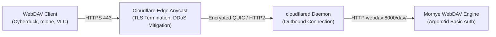

# Mornye Network Storage — Cloudflare Zero-Trust Tunnel Guide

Authoritative reference for WAN edge ingress, Zero-Trust network architecture, credential management, and tunnel daemon operations in Mornye Network Storage.

---

## 1. Zero-Trust Ingress Architecture

Mornye Network Storage connects to Cloudflare's global edge network via an **outbound-only** Zero-Trust tunnel (`cloudflared`):



### Key Security & Network Properties:
1. **Zero Open Inbound Ports**: The host firewall and router require **no port forwarding** (ports 80 and 443 remain completely closed to inbound WAN traffic).
2. **NAT & CGNAT Traversal**: Outbound connections over UDP/QUIC (port 7844) or HTTPS traverse Carrier-Grade NAT and residential dynamic IPs seamlessly.
3. **Strict Origin Ingress Rules**:
   - In container mode (recommended): `storage.example.com` routes directly over Docker's bridge network (`mornye-net`) to `http://webdav:8000`.
   - In host mode: routes strictly to loopback `http://127.0.0.1:8001` (or configured `MORNYE_HOST_PORT`).
   - Default catch-all rule `http_status:404` rejects all unmapped hostnames, IPs, and scan traffic.
4. **Host Port & Service Isolation**:
   - Host port 8000 is reserved for existing host services (such as SONG Bridge / `mornye-storage.service`).
   - Mornye host loopback defaults to port `8001` (`127.0.0.1:8001`), completely avoiding host port collisions.
5. **Exposition Boundary**: Management ports, database files, Docker sockets, and internal APIs are strictly segregated from the tunnel ingress and never exposed to the public Internet.

---

## 2. Configuration & Credentials Architecture

Cloudflare Zero-Trust uses two fundamentally distinct cryptographic files:

| Artifact | File Path | Format & Contents | Function | Restriction |
|---|---|---|---|---|
| **Origin / Account Certificate** | `~/.cloudflared/cert.pem` | PEM-encoded X.509 cert and RSA private key | Authorizes `cloudflared` CLI with Cloudflare account to create, list, and delete tunnels | **Never** pass as `credentials-file` or rename to `credentials.json` |
| **Tunnel Credentials File** | `config/credentials.json` | JSON object: `AccountTag`, `TunnelSecret`, `TunnelID` | Cryptographically authenticates the tunnel daemon to Cloudflare edge routers | Must have mode `644` so container user `nonroot` can read it |
| **Tunnel Metadata** | `config/tunnel_info.env` | Key-value shell environment | Stores Tunnel ID, Name, Custom Domain, and Mode | Hardened with mode `600` |
| **Ingress Configuration** | `config/cloudflared.yml` | Structured YAML | Declares domain-to-origin routing rules and catch-all 404 | Mode `644` |

### Critical Credential Invariants:
> [!IMPORTANT]
> - `cert.pem` is an **Origin Certificate**, NOT a tunnel credential file. Renaming or copying `cert.pem` to `credentials.json` causes fatal JSON parsing crashes in `cloudflared`.
> - If `credentials.json` is missing on a system where the tunnel was already created, Mornye executes `cloudflared tunnel token <UUID>` to retrieve the base64 token, decodes the payload, and automatically reconstructs a valid `credentials.json` file.
> - `config/credentials.json` must always exist as a regular file before starting the container stack. If a bad mount created it as a directory, Mornye detects and corrects the artifact automatically.

### Ingress Configuration Template (`config/cloudflared.yml`):
```yaml
tunnel: 463ff5f0-ead1-4e10-ba29-92b3e48abf66
credentials-file: /etc/cloudflared/credentials.json

ingress:
  # Public WebDAV ingress for remote clients
  - hostname: storage.example.com
    service: http://webdav:8000
    originRequest:
      connectTimeout: 30s
      noTLSVerify: true

  # Default catch-all (strictly reject unmapped hostnames)
  - service: http_status:404
```

---

## 3. Tunnel Service Management: Docker Container Mode

Mornye runs its production Cloudflare Tunnel as a managed Docker container:
- **Container Name:** `mornye-tunnel`
- **Base Image:** `cloudflare/cloudflared:latest`
- **Security User:** `user: "nonroot"` (unprivileged)
- **Network:** Attached to `mornye-net` bridge network
- **Profile:** Managed via Docker Compose profile `tunnel`

### Lifecycle Management Commands:
```bash
# Interactive guided setup (Login, Create, Domain route, Start)
./mornye.sh tunnel setup

# Authenticate with Cloudflare via browser OAuth
./mornye.sh tunnel login

# Create or reuse existing named tunnel (defaults to mornye-storage)
./mornye.sh tunnel create [name]

# Bind a custom domain and configure DNS CNAME routing
./mornye.sh tunnel domain add storage.example.com

# Safely detach custom domain routing
./mornye.sh tunnel domain remove

# Start permanent tunnel container
./mornye.sh tunnel start

# Stop permanent tunnel container
./mornye.sh tunnel stop

# Restart permanent tunnel container
./mornye.sh tunnel restart

# Display tunnel health, edge connections, latency and domain mapping
./mornye.sh tunnel status

# Tail real-time tunnel logs
./mornye.sh tunnel logs -f 50

# Probe end-to-end WAN reachability and auth boundary
./mornye.sh tunnel test
```

---

## 4. Protected Services Guarantee

Mornye maintains strict isolation from existing host services:
- **`mornye-tunnel.service` on Host:** If an existing systemd unit named `mornye-tunnel.service` is operating on the host (listening on port 20241), Mornye **never** stops, restarts, or modifies it. Mornye's tunnel runs strictly inside Docker (`container_name: mornye-tunnel`).
- **`mornye-storage.service` on Port 8000:** SONG Bridge remains fully protected on port 8000. Mornye binds to port 8001 on the host loopback.

---

## 5. Ephemeral Quick Tunnels (Testing Mode)

For temporary WAN access or testing without requiring a Cloudflare account or custom domain:

```bash
# Launch a temporary Quick Tunnel via trycloudflare.com
./mornye.sh tunnel quick start

# Inspect Quick Tunnel status and active public URL
./mornye.sh tunnel quick status

# Tail Quick Tunnel connection logs
./mornye.sh tunnel quick logs -f

# Terminate active Quick Tunnel session
./mornye.sh tunnel quick stop
```

> [!WARNING]
> Quick Tunnels generate a random `*.trycloudflare.com` URL that expires when the process terminates. Use permanent Zero-Trust tunnels for production stability.
