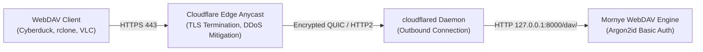

# Mornye Network Storage — Cloudflare Zero-Trust Tunnel Guide

Authoritative reference for WAN edge ingress, Zero-Trust network architecture, and tunnel daemon management in Mornye Network Storage.

---

## 1. Zero-Trust Ingress Architecture

Mornye Network Storage connects to Cloudflare's global edge network via an **outbound-only** Zero-Trust tunnel (`cloudflared`):



### Key Security Properties:
1. **Zero Open Inbound Ports**: The host firewall and router require **no port forwarding** (ports 80 and 443 remain completely closed to inbound WAN traffic).
2. **NAT & CGNAT Traversal**: Outbound connections over UDP/QUIC (port 7844) or HTTPS traverse Carrier-Grade NAT and residential dynamic IPs seamlessly.
3. **Strict Origin Ingress Rules**:
   - `storage.example.com` routes strictly to `http://127.0.0.1:8000` (or `http://webdav:8000` in container mode).
   - Default catch-all rule `http_status:404` rejects all unmapped hostnames, IPs, and scan traffic.
4. **Exposition Boundary**: Management ports, database files, Docker sockets, and internal APIs are strictly segregated from the tunnel ingress and never exposed to the public Internet.

---

## 2. Configuration & Credentials Architecture

All Cloudflare assets reside within the hardened `config/` directory:

| File | Purpose | Security Mode |
|---|---|---|
| `config/cloudflared.yml` | Ingress configuration mapping domains to origin service | `chmod 600` |
| `config/credentials.json` | Tunnel private key, secret token, and account ID | `chmod 600` |
| `config/tunnel_info.env` | Metadata persistence (Tunnel ID, Name, Domain, Mode) | `chmod 600` |
| `~/.cloudflared/cert.pem` | Cloudflare account certificate generated during login | `chmod 600` |

### Ingress Configuration Template (`config/cloudflared.yml`):
```yaml
tunnel: <TUNNEL_UUID>
credentials-file: /etc/cloudflared/credentials.json

ingress:
  # Public WebDAV ingress for remote clients
  - hostname: storage.example.com
    service: http://webdav:8000

  # Default catch-all (strictly reject unmapped hostnames)
  - service: http_status:404
```

---

## 3. Dual Service Runtimes: Docker vs Systemd

Mornye supports two tunnel execution modes depending on operator preference:

### Mode A: Docker Container Mode (Recommended)
- The tunnel runs as a container (`mornye-tunnel`) using the official `cloudflare/cloudflared:latest` image.
- Runs with unprivileged user `user: "nonroot"`.
- Communicates directly over the private internal Docker bridge (`mornye-net`).
- Managed via:
  ```bash
  docker compose --profile tunnel up -d
  # Or via unified CLI:
  ./mornye.sh tunnel start
  ```

### Mode B: Host Systemd Service Mode
- The tunnel runs as a native host unit (`mornye-tunnel.service`).
- Connects to WebDAV on `http://127.0.0.1:8000`.
- Automatically restarts on system reboot or unexpected network failure.

---

## 4. CLI Tunnel Command Reference

All tunnel operations are consolidated under `./mornye.sh tunnel`:

### Permanent Tunnel Commands
```bash
# Interactive guided setup (Login, Create, Domain route, Start)
./mornye.sh tunnel setup

# Authenticate with Cloudflare via browser OAuth
./mornye.sh tunnel login

# Create a new named tunnel (defaults to mornye-storage)
./mornye.sh tunnel create [name]

# Bind a custom domain and configure DNS CNAME routing
./mornye.sh tunnel domain add storage.example.com

# Safely detach custom domain routing
./mornye.sh tunnel domain remove

# Start permanent tunnel daemon
./mornye.sh tunnel start

# Stop permanent tunnel daemon
./mornye.sh tunnel stop

# Restart permanent tunnel daemon
./mornye.sh tunnel restart

# Display tunnel health, edge connections, latency and domain mapping
./mornye.sh tunnel status

# Tail real-time tunnel logs
./mornye.sh tunnel logs -f 50

# Probe end-to-end WAN reachability and auth boundary
./mornye.sh tunnel test
```

---

## 5. Ephemeral Quick Tunnels (Testing Mode)

For temporary WAN access or testing without requiring a Cloudflare account or custom domain:

```bash
# Launch a temporary Quick Tunnel via trycloudflare.com
./mornye.sh tunnel quick start

# Inspect Quick Tunnel status and active public URL
./mornye.sh tunnel quick status

# Tail Quick Tunnel connection logs
./mornye.sh tunnel quick logs -f

# Terminate active Quick Tunnel session
./mornye.sh tunnel quick stop
```

> [!WARNING]
> Quick Tunnels generate a random `*.trycloudflare.com` URL that expires when the process terminates. Use permanent Zero-Trust tunnels for production stability.

