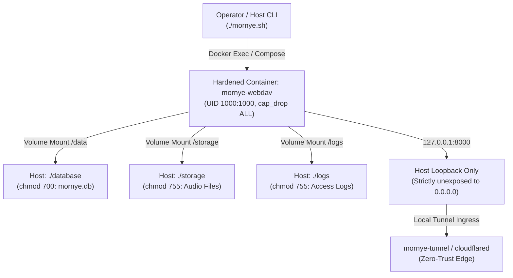

# Mornye Network Storage — Docker Architecture & Runtime Guide

Technical documentation for the containerized runtime, security boundaries, and Docker Compose configurations of Mornye Network Storage.

---

## 1. Architectural Philosophy: Containerized & Host-Independent

Mornye Network Storage v3.1 is engineered as a **Docker-only** infrastructure platform:
- **Zero Host Python Footprint**: No Python packages, interpreters, or virtual environments (`venv`) are required on the host Linux machine.
- **Strict Isolation**: Application code, WebDAV HTTP engine, SQLite ORM models, and metadata scanners execute solely inside the hardened `mornye-webdav` container.
- **Operator Convenience**: Management scripts (`./mornye.sh`) interface with the container via Docker Compose API (`docker compose exec` and `docker compose run`), providing an instant, native Linux CLI experience.



---

## 2. Hardened Multi-Stage Dockerfile

The Mornye container is built using a two-stage Docker architecture (`Dockerfile`):

### Stage 1: Build & Wheel Compilation (`builder`)
- Base: `python:3.11-slim-bookworm`
- Installs temporary compilation toolchains: `gcc`, `g++`, `libffi-dev`, `python3-dev`.
- Compiles application dependencies into standalone pre-compiled wheels in `/wheels`.
- Ensures zero build tools leak into the production container.

### Stage 2: Hardened Runtime Container (`runner`)
- Base: Minimal `python:3.11-slim-bookworm`
- Installs only runtime essentials: `curl` (for health probes), `libmagic1` (for MIME-type analysis), `sqlite3` (CLI integrity tool), `ffmpeg` (audio metadata parser).
- Installs the pre-built wheels without downloading or compiling anything on the fly.
- Creates an unprivileged system user and group: `mornye` (UID `1000`, GID `1000`).
- Drops root privileges completely before entrypoint execution.

---

## 3. Container Security Hardening Matrix

| Security Control | Implementation | Purpose |
|---|---|---|
| **Unprivileged UID/GID** | `user: "1000:1000"` | Prevents container processes from having root privileges on the host kernel. |
| **No New Privileges** | `security_opt: - no-new-privileges:true` | Disallows `setuid`/`setgid` binaries from escalating privileges within the container. |
| **Capability Dropping** | `cap_drop: - ALL` | Strips all 41 Linux kernel capabilities from the container runtime. |
| **Network Loopback Binding** | `ports: - "127.0.0.1:8000:8000"` | Binds port 8000 strictly to host loopback. Never binds to `0.0.0.0`. |
| **Read-Only Ingress Mounts** | Config volumes `:ro` | Prevents the Cloudflare container from modifying credentials or YAML routing rules. |

---

## 4. Volume Mounts & Persistence Layout

Mornye separates application logic from persistent user data:

| Host Directory | Container Mount | Mode | Description |
|---|---|---|---|
| `./database/` | `/data` | `rw` | SQLite database `mornye.db`, WAL logs, and temporary quarantine cache. |
| `./storage/` | `/storage` | `rw` | RFC 4918 physical music storage catalog and user directories. |
| `./logs/` | `/logs` | `rw` | Structured WebDAV HTTP access logs and container event logs. |
| `./config/cloudflared.yml` | `/etc/cloudflared/config.yml` | `ro` | (Tunnel container only) Ingress routing rules. |
| `./config/credentials.json` | `/etc/cloudflared/credentials.json` | `ro` | (Tunnel container only) Tunnel private credentials. |

---

## 5. Docker Compose Profiles

Mornye uses Docker Compose v2 Profiles (`compose.yaml`):

### Default Profile (WebDAV Only)
To run WebDAV without a containerized tunnel:
```bash
docker compose up -d
# Or via CLI:
./mornye.sh start
```

### Profile `tunnel` (WebDAV + Cloudflare Tunnel)
To run both the WebDAV engine and the Zero-Trust Cloudflare Tunnel in containers:
```bash
docker compose --profile tunnel up -d
```
The `tunnel` container depends on `webdav` with `condition: service_healthy`, ensuring the tunnel daemon only starts after WebDAV passes health checks.

---

## 6. Container Healthcheck Protocol

The container includes an automated healthcheck script (`docker/healthcheck.sh`):
- **Interval**: 20 seconds
- **Timeout**: 5 seconds
- **Retries**: 3 attempts
- **Start Period**: 10 seconds grace period
- **Probe Target**: `GET http://127.0.0.1:8000/health`
- **Success Criteria**: HTTP 200 with JSON payload `{"status": "healthy"}`.

If the healthcheck fails 3 consecutive times, Docker marks the container unhealthy and reports it via `docker compose ps` and `./mornye.sh doctor`.

---

## 7. Docker Operations Reference

All standard container operations can be controlled via `./mornye.sh docker`:

```bash
# View Docker daemon and system telemetry
./mornye.sh docker status

# List active Mornye container instances
./mornye.sh docker ps

# Launch stack in background
./mornye.sh docker up

# Stop and gracefully tear down stack
./mornye.sh docker down

# Rebuild image from scratch without layer cache
./mornye.sh docker rebuild

# Tail real-time container logs
./mornye.sh docker logs

# Inspect live container healthcheck status
./mornye.sh docker health
```

