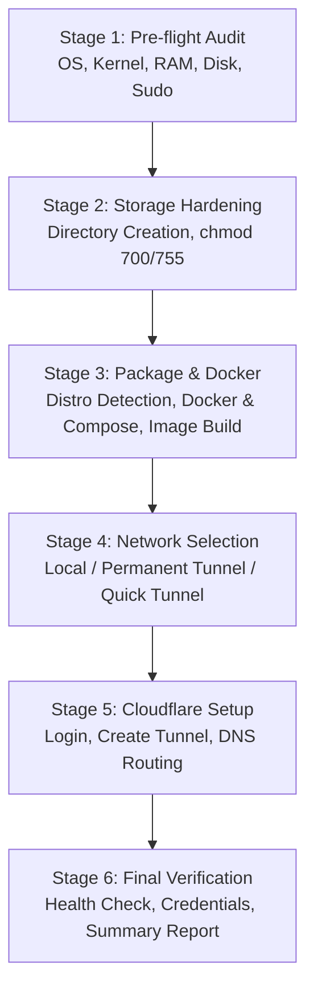

# Mornye Network Storage — Universal Installation Guide

Production-grade, automated multi-distribution Linux installer for Mornye Network Storage and WebDAV infrastructure.

---

## 1. System Requirements & Hardware Prerequisites

Before deploying Mornye Network Storage, ensure your host satisfies the baseline hardware and operational criteria:

| Parameter | Minimum Requirement | Recommended Production |
|---|---|---|
| **CPU Architecture** | `x86_64` (amd64) or `aarch64` (arm64) | 2+ Physical CPU Cores |
| **System Memory (RAM)** | 1.0 GB Available | 2.0 GB+ RAM |
| **Storage Capacity** | 2.0 GB Free Root Disk | 100+ GB for Music Storage Volume |
| **Operating System** | Linux (Kernel 5.4+) | Debian 12+, Ubuntu 22.04/24.04, Arch, Fedora 40+, Rocky 9 |
| **Privileges** | Sudo / Wheel access | Non-root operator with passwordless or cached sudo |
| **Network** | Outbound HTTPS (Port 443) | Outbound HTTPS to Docker Hub & Cloudflare Edge |

> [!IMPORTANT]
> **Host Independence Guarantee**: Mornye operates entirely containerized. You do **not** need Python installed on your host machine, and no Python virtual environments are placed on the host filesystem.

---

## 2. One-Command Quick Start

To install Mornye Network Storage on any supported Linux distribution, run:

```bash
git clone https://github.com/navyaXdev/Mornye-Network-Storage.git
cd Mornye-Network-Storage
./mornye.sh install
```

Alternatively, direct execution of the setup wizard:

```bash
./setup.sh
```

---

## 3. The 6-Stage Automated Installation Wizard

The universal installer executes a guided, deterministic 6-stage lifecycle:



### Stage 1: Pre-flight System Audit
- Sudo privilege validation with background keepalive loop (prevents sudo timeout during long installations).
- Kernel release (`uname -r`) and CPU architecture normalization (`x86_64` / `aarch64` / `armhf`).
- Memory availability check ($\ge 1024 \text{ MB}$).
- Free storage headroom verification ($\ge 2048 \text{ MB}$).

### Stage 2: Storage Provisioning & Permission Hardening
Creates the required host-persisted directory layout with strict Unix permission boundaries and resolves non-root container ownership:
- Resolves invoking user (`SUDO_USER` or current user) and target non-root container UID/GID (`MORNYE_UID`, `MORNYE_GID`).
- `database/` (mode `750`) — SQLite database files and write-ahead logs, owned by container UID.
- `backups/` (mode `750`) — Hot online snapshots and disaster recovery archives.
- `config/` (mode `750`) — Secret tokens, encryption keys, and Cloudflare credentials.
- `storage/` (mode `755`) — Physical audio files cataloged under RFC 4918 WebDAV.
- `logs/` (mode `755`) — WebDAV access logs and daemon runtime logs.
- `run/` (mode `755`) — Process IDs and ephemeral state sockets.

Generates a cryptographically strong 256-bit URL-safe `SECRET_KEY` in `.env` if one does not already exist, and exports `MORNYE_UID` / `MORNYE_GID`.

### Stage 3: Universal Package & Docker Runtime Setup
Detects the host package manager and installs missing dependencies automatically:
- **Debian / Ubuntu / Kali / Mint**: `apt` (installs `docker.io` + `docker-cli` or official Docker CE repo, `docker-compose-plugin`, `curl`, `ca-certificates`, `cloudflared`).
- **Arch Linux / Manjaro / EndeavourOS**: `pacman` (installs `docker`, `docker-compose`, `cloudflared`).
- **Fedora / RHEL / Rocky / AlmaLinux**: `dnf` / `yum` (configures Docker CE repo, installs `docker-ce`, `docker-compose-plugin`, `cloudflared`).
- **openSUSE Leap / Tumbleweed**: `zypper` (installs `docker`, `docker-compose`, `cloudflared`).
- **Alpine Linux**: `apk` (installs `docker`, `docker-cli-compose`, enables Docker on OpenRC boot).

Ensures the invoking user is added to the `docker` group, starts the Docker daemon, and builds the production multi-stage image `mornye-webdav:latest`.

### Stage 4: Networking Mode Selection
The installer prompts the operator to choose their deployment topology:
1. **Local Network Only**: WebDAV service binds strictly to `127.0.0.1:8000`. No WAN exposure.
2. **Permanent Zero-Trust Cloudflare Tunnel (Production)**: Automated Cloudflare login, named tunnel creation, custom domain binding, and DNS CNAME propagation.
3. **Ephemeral Quick Tunnel (Testing)**: Instant public testing endpoint via `*.trycloudflare.com` without requiring a Cloudflare account.

### Stage 5: Cloudflare Workflow Execution
If option 2 or 3 is selected, the installer invokes `scripts/cloudflare_manager.sh` to configure credentials, configure the ingress rules (`/etc/cloudflared/config.yml`), and start the tunnel service.

### Stage 6: Final Verification & Post-Install Report
Runs an end-to-end sanity audit:
- WebDAV `/health` endpoint probe (expects HTTP 200).
- WebDAV `/dav/` authentication probe (expects HTTP 401 Unauthorized for unauthenticated requests).
- SQLite PRAGMA integrity check.
- Exports a full markdown report to `docs/SETUP_DEPENDENCY_INSTALLATION_REPORT.md`.

---

## 4. Advanced Installer Flags & Options

The installer supports non-interactive execution for continuous deployment or automated testing:

```bash
# Non-interactive local installation (defaults to local mode)
./setup.sh --yes --mode local

# Non-interactive with permanent tunnel creation
./setup.sh --yes --mode tunnel --tunnel-name my-mornye --domain storage.mydomain.com

# Non-interactive with temporary Quick Tunnel test
./setup.sh --yes --mode quick
```

---

## 5. Post-Installation Verification & Universal Diagnostics

Once installation is complete, verify the operational state using Mornye's diagnostic suite:

```bash
# 1. Run complete universal system diagnostic audit
./mornye.sh doctor

# 2. Output machine-readable JSON telemetry for monitoring systems
./mornye.sh doctor --json

# 3. Safely auto-repair detected permission, port, or environment issues
./mornye.sh doctor --fix

# 4. Inspect port bindings and detect conflicts without terminating services
./mornye.sh ports

# 5. Measure endpoint responsiveness and latency (/health and /dav/)
./mornye.sh health

# 6. Validate configuration files (.env, compose.yaml, ingress)
./mornye.sh config validate

# 7. Check unified infrastructure overview
./mornye.sh status

# 8. Probe WebDAV storage endpoint
./mornye.sh webdav test
```

---

## 6. Port Management & Service Coexistence Architecture

Mornye is engineered for safe coexistence with pre-existing host services (such as SONG Bridge, Navidrome, Nginx, or legacy units):

- **Internal Container WebDAV Port**: `8000` (strict RFC 4918 specification).
- **Configurable Host Binding**: `MORNYE_HOST_BIND=127.0.0.1` and `MORNYE_HOST_PORT=8001` (configured via `.env`).
- **Coexistence Guarantee**: If port 8000 is occupied by an existing process (e.g., SONG Bridge), Mornye maps `127.0.0.1:8001:8000`. Both services run simultaneously on the host with zero port collision and zero downtime.
- **Service Protection Policy**: Mornye's diagnostic and repair engine **never** terminates, stops, or modifies unrelated host processes. In case of port conflict, it identifies the occupying process (PID, cgroup unit, working directory) and offers automatic safe reassignment to an alternative free port in the 8001–8099 range.

