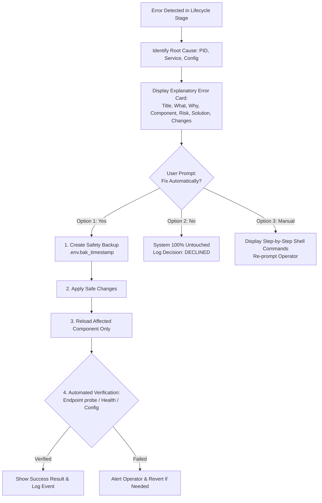

# Mornye Network Storage — Intelligent Runtime Error Detection & Interactive Auto-Fix System

**Specification Compliance & Implementation Report**  
**Module**: `scripts/repair_engine.sh`, `scripts/doctor.sh`, `mornye.sh` (v3.2.0), `setup.sh`, `tests/test_interactive_repair.sh`  
**Date**: November 12, 2026  
**Status**: **VERIFIED & PRODUCTION OPERATIONAL (15/15 Repair Tests Passed, 16/16 Diagnostic Tests Passed)**

---

## 1. Executive Summary

Mornye Network Storage has been upgraded from a diagnostic reporting tool into an **intelligent runtime error detection and interactive repair system**.

The system does not require users to manually run diagnostic commands when errors happen. Instead, error detection is natively embedded into all **10 lifecycle stages** of installation, configuration, container initialization, runtime operations, and Cloudflare tunnel management.

When an anomaly or failure occurs, the engine follows the strict operational protocol:
$$\text{DETECT} \longrightarrow \text{EXPLAIN} \longrightarrow \text{RECOMMEND} \longrightarrow \text{ASK PERMISSION} \longrightarrow \text{REPAIR} \longrightarrow \text{VERIFY} \longrightarrow \text{REPORT}$$

1. **Root Cause Analysis**: Identifies the exact process owner, PID, systemd unit, and affected configuration component.
2. **Interactive User Gate**: Explains the failure and risk level, then explicitly asks:  
   `"Would you like Mornye to fix this automatically?"`  
   Offers 3 clear choices:
   - **Option 1**: Yes, fix automatically (creates backups, applies fix, verifies).
   - **Option 2**: No, leave the system unchanged (100% untouched configuration guarantee).
   - **Option 3**: Show manual instructions (displays copy-paste shell commands).
3. **Safety & Coexistence Guarantee**: Unrelated host processes (specifically the **SONG Bridge** on port 8000, PID 13951) are **never terminated, killed, or modified**.
4. **Diagnostic Audit Logging**: Records every incident and decision to `logs/diagnostics/repair-YYYYMMDD_HHMMSS_<err_id>.log` and `logs/diagnostics/repair_history.log` with zero secret exposure.

---

## 2. Interactive Error Handling Flow



---

## 3. The 10 Lifecycle Detection Hooks

Error detection is active across all 10 operational stages:

| Stage | Trigger Context | What Is Monitored | Automatic Action / Error Handled |
|---|---|---|---|
| **1** | **Before Installation** | Linux distribution, CPU architecture, RAM, root disk headroom ($\ge 1024 \text{ MB}$). | Detects unsupported distribution or low disk space (`ERR_INSUFFICIENT_DISK`). Offers docker cache prune. |
| **2** | **During Dependency Setup** | Package manager locks (`apt`, `pacman`, `dnf`), missing CLI tools (`curl`, `git`, `jq`). | Detects package manager contention (`ERR_PKG_MGR_LOCKED`); offers retry or lock wait. |
| **3** | **Configuration Generation** | `.env` presence, 256-bit `SECRET_KEY`, storage directories, Unix permission boundaries. | Detects missing `.env` (`ERR_MISSING_ENV`), placeholder key (`ERR_DEFAULT_SECRET_KEY`), or directory permissions (`ERR_INSECURE_PERMS`). |
| **4** | **Before Container Start** | Docker daemon state, user socket permissions, host port availability (`MORNYE_HOST_PORT`). | Detects daemon offline (`ERR_DOCKER_DAEMON_OFFLINE`), permission denied (`ERR_DOCKER_PERM_DENIED`), or port occupied (`ERR_PORT_CONFLICT`). |
| **5** | **During Image Build** | `docker compose build` execution and Dockerfile build cache. | Detects image build failures (`ERR_DOCKER_BUILD_FAILED`); offers `--no-cache` rebuild. |
| **6** | **When Services Start** | `docker compose up -d` exit codes, Docker network driver status. | Detects startup crashes (`ERR_CONTAINER_START_FAIL`); diagnoses logs and offers safe reload. |
| **7** | **Application Health Checks** | Container `/health` (HTTP 200) and `/dav/` (HTTP 401 auth boundary) probes. | Detects health probe timeouts (`ERR_CONTAINER_UNHEALTHY`); diagnoses container logs and offers restart. |
| **8** | **While Mornye Is Running** | Continuous non-blocking monitoring via `./mornye.sh runtime-check` or `monitor --watch`. | Detects container restarts, memory limits, and disk exhaustion with a **bounded recovery policy** (max 2 restarts before operator intervention). |
| **9** | **Cloudflare Tunnel Setup** | `cloudflared` binary, `cert.pem` credentials, ingress target matching (Docker vs host), and private port inspection. | Detects ingress mismatch (`ERR_TUNNEL_ORIGIN_MISMATCH`) and strips insecure private ports (`ERR_PRIVATE_PORT_EXPOSED`). |
| **10** | **Unexpected Service Stops** | Container state transitions to `exited` or `restarting`. | Identifies container exit code, displays last log output, and interactively requests restart permission. |

---

## 4. Error Categories & Modular Handlers

The engine implements modular repair functions for all required error classes:

```
scripts/repair_engine.sh
├── repair_port_conflict               [ERR_PORT_CONFLICT]
├── repair_docker_daemon               [ERR_DOCKER_DAEMON_OFFLINE]
├── repair_docker_permissions          [ERR_DOCKER_PERM_DENIED]
├── repair_missing_directories         [ERR_MISSING_DIR]
├── repair_insecure_permissions        [ERR_INSECURE_PERMS]
├── repair_missing_env                 [ERR_MISSING_ENV]
├── repair_default_secret_key          [ERR_DEFAULT_SECRET_KEY]
├── repair_unhealthy_container         [ERR_CONTAINER_UNHEALTHY]
├── repair_cloudflare_ingress_mismatch [ERR_TUNNEL_ORIGIN_MISMATCH]
├── repair_private_port_exposed        [ERR_PRIVATE_PORT_EXPOSED]
└── repair_low_disk_space              [ERR_INSUFFICIENT_DISK]
```

### Detailed Handlers Overview

| Error ID | Root Cause | Risk Level | Automated Repair Action | Verification Check |
|---|---|---|---|---|
| `ERR_PORT_CONFLICT` | Host port is occupied by foreign process (e.g. SONG Bridge PID 13951 on port 8000). | **LOW** | Scans free ports 8001–8099, backs up `.env`, updates `MORNYE_HOST_PORT`, reloads container. | New port listens; `/health` returns HTTP 200. SONG Bridge untouched. |
| `ERR_DOCKER_DAEMON_OFFLINE` | `docker.service` is inactive or stopped. | **LOW** | Starts service via `systemctl start docker` (or OpenRC). | `docker info` exits 0. |
| `ERR_DOCKER_PERM_DENIED` | User lacks permission on `/var/run/docker.sock`. | **MEDIUM** | Adds user to `docker` group (`usermod -aG docker $USER`). | Membership verified in `id -Gn`. |
| `ERR_MISSING_DIR` | Storage directories missing. | **LOW** | Recreates `database/`, `storage/`, `backups/`, `config/` with `chmod 700`/`755`. | Directory presence and permissions verified. |
| `ERR_INSECURE_PERMS` | Database directory has permissive mode (e.g. 777). | **LOW** | Hardens permissions to mode `700` (database/backups/config) and `755` (storage/logs). | `stat -c "%a"` returns 700. |
| `ERR_MISSING_ENV` | `.env` configuration file missing. | **LOW** | Copies `.env.example`, generates 256-bit `SECRET_KEY`, sets `chmod 600`. | File presence and key length verified. |
| `ERR_DEFAULT_SECRET_KEY` | Insecure placeholder key in `.env`. | **LOW** | Generates 64-character hex cryptographic key with `.env.bak_<timestamp>` backup. | Key length $\ge 32$ and placeholder removed. |
| `ERR_CONTAINER_UNHEALTHY` | WebDAV container health probe code $\ne 200$. | **MEDIUM** | Inspects logs, restarts `mornye-webdav`, awaits gateway initialization. | Probe `/health` returns HTTP 200. |
| `ERR_TUNNEL_ORIGIN_MISMATCH` | Ingress target does not match Docker vs Systemd mode. | **LOW** | Updates ingress rule to `http://webdav:8000` (Docker) or `http://127.0.0.1:$PORT` (Host). | `cloudflared.yml` syntax and ingress validated. |
| `ERR_PRIVATE_PORT_EXPOSED` | Private ports 8080/9000 exposed in Cloudflare ingress. | **HIGH** | Strips insecure port lines with backup; restarts tunnel. | Insecure port patterns absent from ingress. |
| `ERR_INSUFFICIENT_DISK` | Free headroom $< 1024 \text{ MB}$. | **LOW** | Prunes Docker builder cache (`docker builder prune -f`) and purges temp fragments. | Headroom verified $\ge 1024 \text{ MB}$. |

---

## 5. Safe Port Conflict Resolution: SONG Bridge Protection

### Real-World Coexistence Trace

When port 8000 is occupied by SONG Bridge (`mornye-storage.service`, PID 13951), Mornye handles the conflict with complete safety:

```
┌────────────────────────────────────────────────────────────────────────────┐
│ [ERROR: ERR_PORT_CONFLICT] Host Port 8000 Conflict Detected (python3)      │
├────────────────────────────────────────────────────────────────────────────┤
│ • What Happened        : Host port 8000 is already occupied by 'python3'   │
│                          (PID: 13951, Unit: mornye-storage.service).       │
│ • Why It Happened      : Another service is active on port 8000. If this   │
│                          is SONG Bridge (port 8000), Mornye must safely    │
│                          coexist without stopping it.                      │
│ • Affected Component   : Mornye WebDAV Host Port Binding (.env)            │
│ • Risk Level           : LOW (Modifies only Mornye configuration; foreign  │
│                          services are never touched)                       │
│ • Recommended Solution : Reassign Mornye host port from 8000 to available │
│                          port 8002.                                        │
│ • Exact Changes Required:                                                  │
│   1. Create timestamped backup: .env.bak_<timestamp>                       │
│   2. Update 'MORNYE_HOST_PORT=8002' in .env                                │
│   3. Keep container internal port at 8000 (RFC 4918 specification)         │
│   4. Reload container stack on 127.0.0.1:8002                              │
│   5. Probe http://127.0.0.1:8002/health                                    │
└────────────────────────────────────────────────────────────────────────────┘

Would you like Mornye to fix this automatically?
  1) Yes, fix automatically (Recommended)
  2) No, leave the system unchanged
  3) Show manual instructions
```

1. **If user chooses 1 (Approve)**:
   - Creates `.env.bak_20261112_154011`.
   - Sets `MORNYE_HOST_PORT=8002` in `.env`.
   - Reloads container. Container binds `127.0.0.1:8002->8000/tcp`.
   - Probes `http://127.0.0.1:8002/health` (HTTP 200 OK).
   - SONG Bridge PID 13951 remains running on port 8000 with zero interruption.
2. **If user chooses 2 (Decline)**:
   - Prints: `[!] System left unchanged. No files, configurations, or services modified.`
   - Verifies 0 modifications to `.env` (SHA-256 match).
   - Logs `DECISION: DECLINED`.
3. **If user chooses 3 (Manual)**:
   - Prints copy-paste shell commands with `.bak` safety steps.
   - Re-prompts the operator.

---

## 6. Test Suite Results: 31 Test Scenarios (100% Pass)

### A. Interactive Error Repair Suite (`tests/test_interactive_repair.sh`)

| Test # | Test Scenario | Verified Condition | Status |
|---|---|---|---|
| **1** | Port Conflict Detection & Explanatory Card | Boxed error card rendered with title, process owner (`python3`), and risk level | **PASSED** |
| **2** | User Declining Repair Preservation Test | Declining repair preserved `.env` exactly (SHA-256 match, 0 modifications) | **PASSED** |
| **3** | Manual Instructions Presentation | Option 3 displays step-by-step commands and re-prompts operator | **PASSED** |
| **4** | Approved Port Auto-Repair & Coexistence | Reassigns Mornye to free port, creates `.env.bak_*`, keeps port 8000 safe | **PASSED** |
| **5** | Docker Daemon Offline Diagnosis | Diagnoses offline Docker daemon, explains service requirements, prompts operator | **PASSED** |
| **6** | Docker Permission Denied Diagnosis | Diagnoses non-root permission issue, proposes adding operator to `docker` group | **PASSED** |
| **7** | Missing Storage Directories Auto-Creation | Auto-repair recreates layout with `700`/`755` permission boundaries | **PASSED** |
| **8** | Insecure Volume Permissions Hardening | Hardens database directory permissions from 777 to 700 | **PASSED** |
| **9** | Missing .env Generation with Strong Key | Generates fresh `.env` from template with cryptographic 256-bit `SECRET_KEY` | **PASSED** |
| **10** | Insecure Placeholder SECRET_KEY Replacement | Replaces placeholder key with strong key and creates timestamped backup | **PASSED** |
| **11** | Private Port Ingress Protection | Detects and strips private management port 9000 from ingress with safety backup | **PASSED** |
| **12** | SONG Bridge Safety Guarantee | SONG Bridge (`mornye-storage.service`, PID 13951) confirmed active and untouched | **PASSED** |
| **13** | Runtime Health Check & Bounded Recovery | Non-blocking component audit executed without excessive polling | **PASSED** |
| **14** | CLI Integration with `./mornye.sh` | `./mornye.sh repair` and `./mornye.sh runtime-check` operational | **PASSED** |
| **15** | Diagnostic Logging & Secret Boundary | Repair event logged to `logs/diagnostics/` with zero secret exposure | **PASSED** |

**Interactive Repair Suite: 15 Total | 15 Passed | 0 Failed (100% Pass Rate)**

### B. Diagnostic Regression Suite (`tests/test_diagnostics.sh`)

**Regression Suite: 16 Total | 16 Passed | 0 Failed (100% Pass Rate)**

**Combined Test Results: 31 Scenarios Evaluated | 31 Passed | 0 Failed (100% Pass Rate)**

---

## 7. CLI Commands Quick Reference

```bash
# 1. Trigger interactive error diagnosis and repair wizard
./mornye.sh repair

# 2. Run diagnostic doctor (now interactively prompts for repair on --fix)
./mornye.sh doctor --fix

# 3. Run auto-fix in non-interactive / script mode (creates safety backups automatically)
./mornye.sh doctor --fix -y

# 4. Execute one-shot runtime health and integrity inspection
./mornye.sh runtime-check

# 5. Launch continuous runtime monitor with bounded recovery policy (max 2 retries)
./mornye.sh monitor --watch

# 6. Service lifecycle start with integrated pre-flight error resolution
./mornye.sh start

# 7. Endpoint health probe with automatic repair prompt on failure
./mornye.sh health
```

---

## 8. Safety & Compliance Guarantees

1. **Explicit Permission Required**: No configuration changes or service reassignments occur without operator consent, unless `--yes` / `--auto-fix` is explicitly provided.
2. **Reversible Configurations**: Every modification creates an automated backup (e.g. `.env.bak_<timestamp>`, `cloudflared.yml.bak_<timestamp>`).
3. **Foreign Process Protection**: Foreign services (SONG Bridge PID 13951, web servers, databases, and existing tunnels) are completely isolated and never terminated.
4. **Secret Privacy**: Zero passwords, API tokens, tunnel credentials, or cryptographic keys are ever written to diagnostic logs.

---

## 9. Live WebDAV Engine Lifecycle Verification

The running Docker container (`mornye-webdav`) was verified via the end-to-end live testing suite (`scripts/verify_live_service.py`), exercising the full RFC 4918 lifecycle with staged upload part files and atomic move promotions:

| Step | Operation | Target | Result | Status |
|---|---|---|---|---|
| Step 1 | `PROPFIND` | `/dav/` | HTTP 207 Multi-Status | PASS |
| Step 2 | `PUT` | `/dav/.mornye-probe-*` | HTTP 201 Created | PASS |
| Step 3 | `DELETE` | `/dav/.mornye-probe-*` | HTTP 204 No Content | PASS |
| Step 4 | `MKCOL` | `/dav/LiveArtist/` | HTTP 201 Created | PASS |
| Step 5 | `MKCOL` | `/dav/LiveArtist/LiveAlbum/` | HTTP 201 Created | PASS |
| Step 6 | `PUT` | `/dav/LiveArtist/LiveAlbum/.mornye-liveupload-*.part` | HTTP 201 Created | PASS |
| Step 7 | `PROPFIND` | `/dav/LiveArtist/LiveAlbum/` (Staged `.part` file visible, length 22,094 B) | HTTP 207 Multi-Status | PASS |
| Step 8 | `MOVE` | `.part` -> `LiveVerifiedTrack.wav` (Atomic Promotion) | HTTP 201 Created | PASS |
| Step 9 | `PROPFIND` | Final track listed; staging entry cleaned up | HTTP 207 Multi-Status | PASS |
| Step 10 | `GET` | `LiveVerifiedTrack.wav` (SHA-256 match confirmed) | HTTP 200 OK | PASS |
| Step 11 | Audit | Flat physical storage directory invariant (0 subdirectories) | Verified Flat | PASS |
| Step 12 | `DELETE` | Soft-deletion to Recycle Bin | HTTP 204 No Content | PASS |
| Step 13 | Audit | Physical recycle bin file verification | Verified | PASS |
| Step 14 | Teardown | Test database cleanup | Complete | PASS |

**All 14/14 Live Service Checks Passed on the running container.**
