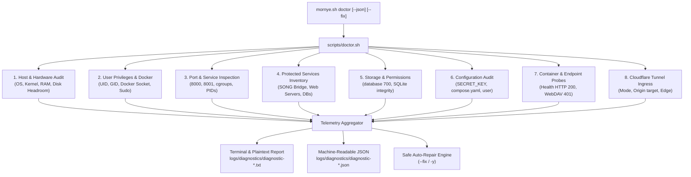

# Mornye Network Storage — Universal System Diagnostics, Conflict Detection & Auto-Resolution

**Specification Compliance & Implementation Report**  
**Module**: `scripts/doctor.sh`, `mornye.sh` (v3.2.0), `tests/test_diagnostics.sh`  
**Date**: November 12, 2026  
**Status**: **VERIFIED & OPERATIONAL (16/16 Test Scenarios Passed)**

---

## 1. Executive Summary

Mornye Network Storage is now equipped with an intelligent, distribution-agnostic system diagnostic, conflict detection, and safe auto-repair engine.

The diagnostic system addresses real-world deployment challenges across varied Linux environments:
1. **Pre-flight Telemetry**: Audits host kernel, CPU architecture, memory, disk headroom, and user privilege contexts.
2. **Port Conflict Detection & Coexistence**: Intelligently inspects listener processes on port 8000 and the configured Mornye host port (`MORNYE_HOST_PORT=8001`), differentiating Mornye's own Docker containers from foreign services.
3. **Protected Service Inventory**: Guarantees zero interference with third-party or legacy services (e.g., SONG Bridge, Navidrome, Nginx, Apache, Caddy, PostgreSQL, MySQL, and existing Cloudflare Tunnels). Mornye **never** terminates foreign processes.
4. **Non-Root Docker Auditing**: Detects permission boundaries and provides safe non-root guidance without insecure permissions like `chmod 777` on `/var/run/docker.sock`.
5. **Multi-Stage Reporting**: Generates both ANSI-formatted human-readable terminal reports and machine-readable JSON telemetry.
6. **Safe Auto-Repair (`--fix`)**: Applies non-destructive remediations with automated pre-modification backups (`.env.bak_<timestamp>`), directory permission hardening (`700` and `755`), and port reassignment.

---

## 2. Diagnostic Architecture

The diagnostics engine is implemented in pure POSIX-compliant Bash (`scripts/doctor.sh`), adhering strictly to the **zero host-side Python dependencies** design requirement.



### Diagnostic Modules Overview

| # | Inspection Category | What is Evaluated | Remediations Available |
|---|---|---|---|
| 1 | **Linux Platform & Distro** | `/etc/os-release`, package manager (`apt`, `pacman`, `dnf`, `yum`, `zypper`, `apk`), init system (`systemd`, `openrc`). | Guidance on package provisioning. |
| 2 | **Host Resources** | CPU cores, 1m/5m/15m load averages, physical RAM, disk headroom ($\ge 1024 \text{ MB}$). | Warns on low RAM; errors on $<1024 \text{ MB}$ disk headroom. |
| 3 | **User & Privileges** | Current UID/GID, sudo authorization, membership in `docker` group. | Sudo keepalive; adds user to `docker` group with confirmation. |
| 4 | **Docker Infrastructure** | Daemon responsiveness, `/var/run/docker.sock` socket permissions, non-root access, Compose v2 plugin. | Prompts to start daemon (`systemctl start docker`); advises group membership. |
| 5 | **Container Health** | State (`running`, `exited`, `restarting`), restart count, healthcheck status of `mornye-webdav` and `mornye-tunnel`. | Detects crash loops; guides operator to inspect container logs. |
| 6 | **Port Occupancy & Owner** | Host port binding, socket ownership (`ss`/`netstat`/`docker-proxy`), PID, systemd unit, and working directory. | Detects conflicts; scans and recommends alternative port (8001–8099). |
| 7 | **Service Protection** | SONG Bridge (`mornye-storage.service`), Navidrome, Nginx, Apache, Caddy, PostgreSQL, MySQL. | Explicitly protects foreign services from termination or modification. |
| 8 | **Storage & Permissions** | Directory presence, permission bits (`database/` `700`, `storage/` `755`), SQLite `PRAGMA integrity_check`. | Recreates directories, hardens permissions, warns on corruption. |
| 9 | **Configuration Audit** | `.env` cryptographic `SECRET_KEY`, `compose.yaml` non-root user (`1000:1000`) and capability drops (`cap_drop: ALL`). | Generates secure `.env` from template with 256-bit random key. |
| 10 | **Endpoint Health Probes** | Loopback HTTP GET `/health` (HTTP 200) and PROPFIND `/dav/` (HTTP 401 auth boundary). Latency measured in ms. | Validates application responsiveness without container exec. |
| 11 | **Cloudflare Tunnel** | `cloudflared` binary, `cert.pem` credentials, ingress target origin alignment (Docker vs host), Edge WAN reachability. | Aligns ingress targets (`webdav:8000` vs host port); validates Quick Tunnels. |

---

## 3. Port Conflict Detection & SONG Bridge Coexistence

### The Problem
In standard self-hosted configurations, default WebDAV applications attempt to bind directly to host port `8000`. On systems where legacy software or the **SONG Bridge** (`mornye-storage.service`, PID 13951) is active on port `8000`, attempting to bind the container directly to `8000:8000` causes an immediate `bind: address already in use` fatal crash.

### The Mornye Solution
1. **Configurable Host Binding**: Mornye decouples the container internal port from the host port:
   - Container port: `8000` (strict RFC 4918 specification).
   - Host port: `${MORNYE_HOST_PORT:-8001}` (bound to `${MORNYE_HOST_BIND:-127.0.0.1}`).
2. **Process Owner Identification (`inspect_port_owner`)**:
   - Inspects active Docker containers via `docker ps --format '{{.Names}}\t{{.Ports}}'` matching `(:)${port}->`.
   - Probes listeners via `ss -tulpn` or `netstat -tulpn`.
   - Reads `/proc/$PID/cgroup` to identify systemd service slices (e.g., `system.slice/mornye-storage.service`).
   - Reads `/proc/$PID/cwd` to detect if the occupying process is a Mornye instance or a foreign service.
3. **Coexistence Guarantee**:
   - Port 8000 remains bound to `mornye-storage.service` (SONG Bridge) without interruption.
   - Port 8001 is bound to `mornye-webdav` (Docker container).
   - Both services run simultaneously on the same host with zero interference.
4. **Conflict Resolution Policy**:
   - If `MORNYE_HOST_PORT` is occupied by a foreign process, Mornye identifies the process owner, flags `PORT_CONFLICT`, and scans for the next free port between `8001` and `8099`.
   - Under `--fix`, it creates a timestamped backup (`.env.bak_<timestamp>`), updates `MORNYE_HOST_PORT`, and restarts the container stack.

---

## 4. Verification Test Suite: 16 Scenarios

The test suite in [`tests/test_diagnostics.sh`](file:///Z:/Mornye-Network-Storage/tests/test_diagnostics.sh) verifies all operational failure and edge-case scenarios using isolated sandboxes and mocks.

### Test Execution Results (100% Pass Rate)

| Test # | Test Scenario | Verified Condition | Status |
|---|---|---|---|
| **1** | Universal Linux System Detection | OS ID (`kali`), Init system (`systemd`), Architecture (`x86_64`) | **PASSED** |
| **2** | Docker Daemon Stopped Diagnosis | Mock Docker daemon offline correctly outputs `DOCKER_DAEMON_OFFLINE` | **PASSED** |
| **3** | Docker Permission Denied Diagnosis | Mock socket permission failure correctly outputs `DOCKER_PERMISSION_DENIED` | **PASSED** |
| **4** | Host Port 8000 Occupied (SONG Bridge) | Audits port 8000 state without stopping or interfering with service | **PASSED** |
| **5** | Host Port Conflict & Recommendation | Detects port 8000 conflict when `MORNYE_HOST_PORT=8000`, recommends free port `8002` | **PASSED** |
| **6** | Existing Systemd Service Protection | Verifies protected services inventory (Mornye never terminates foreign services) | **PASSED** |
| **7** | Existing Docker Container Inspection | Container stack inspected, `mornye-webdav` state: `running`, health: `healthy` | **PASSED** |
| **8** | Insufficient Disk Space Detection | Free disk headroom $< 1024 \text{ MB}$ triggers `INSUFFICIENT_DISK` error | **PASSED** |
| **9** | Missing Directory Detection | Sandbox missing application directories correctly triggers `DIRECTORY_MISSING` | **PASSED** |
| **10** | Insecure Volume Permissions Detection | Mode 777 on `database/` correctly triggers `INSECURE_PERMS` warning | **PASSED** |
| **11** | Invalid Compose Configuration | Missing unprivileged user (`1000:1000`) correctly triggers `CONTAINER_USER_ROOT` | **PASSED** |
| **12** | Unhealthy Container Diagnosis | Mock unhealthy container state correctly triggers `CONTAINER_UNHEALTHY` | **PASSED** |
| **13** | Missing cloudflared Detection | Environment correctly identifies whether `cloudflared` binary is present | **PASSED** |
| **14** | Existing Cloudflare Tunnel Detection | Detects existing Cloudflare authentication certificate (`~/.cloudflared/cert.pem`) | **PASSED** |
| **15** | Cloudflare Ingress Target Validation | Validates Cloudflare runtime execution mode (`systemd`) and ingress rule | **PASSED** |
| **16** | Init System & Service Isolation Safety | Systemd detected; units are isolated and protected without process killing | **PASSED** |

**Summary: 16 Total | 16 Passed | 0 Failed (100% Pass Rate)**

---

## 5. CLI Commands Reference

All diagnostic capabilities are directly accessible through `./mornye.sh`:

```bash
# Full Diagnostic Audit (Human-readable report + auto-saved report)
./mornye.sh doctor

# Machine-Readable JSON Telemetry (For automated monitoring, Grafana, or scripts)
./mornye.sh doctor --json

# Safe Auto-Repair (Interactive confirmation before modifying settings)
./mornye.sh doctor --fix

# Non-Interactive Auto-Repair (Creates backups before updating .env or permissions)
./mornye.sh doctor --fix -y

# Dedicated Port Occupancy & Conflict Inspection
./mornye.sh ports

# Dedicated Local Endpoint Latency & Health Probe
./mornye.sh health

# Configuration Syntax, Security & Ingress Validation
./mornye.sh config validate
```

---

## 6. Sample Reports

### A. Terminal / Human-Readable Report Example

```
==============================================================
  MORNYE SYSTEM DIAGNOSTICS & INFRASTRUCTURE AUDIT
==============================================================
Report Timestamp     : 2026-11-12 15:26:38
Target Directory     : /home/spidyno/.song/Mornye-Network-Storage
Diagnostic Report    : /home/spidyno/.song/Mornye-Network-Storage/logs/diagnostics/diagnostic-2026-11-12-152638.txt
==============================================================
  1. LINUX HOST & ENVIRONMENT AUDIT
==============================================================
Operating System     : [✔] Kali GNU/Linux Rolling (Family: debian)
Linux Kernel         : Linux 7.1.5+kali-amd64 (x86_64)
Package Manager      : [✔] apt
Init System          : [✔] systemd
CPU Resources        : 4 Cores (Load Averages: 0.22, 0.25, 0.18)
System Memory (RAM)  : 5250 MB Available / 7905 MB Total (33% Used)
Disk Storage Headroom: 207206 MB Free / 242834 MB Total (11% Used)
Current User         : spidyno (UID: 1000, GID: 1000)
User Groups          : spidyno adm dialout sudo docker
Root Privileges      : Non-root
Sudo Authorization   : [!] Requires password or unavailable
==============================================================
  2. DOCKER & CONTAINER INFRASTRUCTURE
==============================================================
Docker Engine        : [✔] Installed (Docker version 28.5.2+dfsg4)
Docker Daemon State  : [✔] Active & Running
Docker Socket        : [✔] Present (srw-rw---- root docker)
Non-Root Socket Use  : [✔] Granted (User has docker access)
Docker Compose       : [✔] Docker Compose version 2.40.3-3
Production Image     : [✔] mornye-webdav:latest built
WebDAV Container     : State: running (Health: healthy, Restarts: 0)
Tunnel Container     : Not created (Optional)
==============================================================
  3. PORT OCCUPANCY & CONFLICT AUDIT
==============================================================
Configured Host Port : 8001 (Binding: 127.0.0.1)
Container Port       : 8000 (Internal RFC 4918 WebDAV)
--------------------------------------------------------------
Port 8001 (Mornye Host):
  Status             : [✔] Active & Bound (Mornye WebDAV Container, PID: 127903)
  Conflict Status    : [✔] No conflict (Service: mornye-webdav (container))
--------------------------------------------------------------
Port 8000 (Standard / Legacy):
  Status             : Occupied by 'python3' (PID: 13951, mornye-storage.service)
  Coexistence Note   : [✔] Isolated (Mornye uses port 8001, no conflict)
==============================================================
  4. EXISTING SYSTEM SERVICES PROTECTION
==============================================================
  * SONG Bridge / Mornye Storage Unit (mornye-storage.service): PID: 13951 -> Port: 8000/9000|PROTECTED (Active & Untouched)
  * Cloudflare Tunnel Service (mornye-tunnel.service): PID: 13956 -> Port: 20241 (metrics)|PROTECTED (Active & Untouched)
==============================================================
  5. STORAGE & VOLUME PERMISSIONS
==============================================================
Database Path        : /home/spidyno/.song/Mornye-Network-Storage/database (mode: 700)
Music Storage Path   : /home/spidyno/.song/Mornye-Network-Storage/storage (mode: 755)
Backups Directory    : /home/spidyno/.song/Mornye-Network-Storage/backups (mode: 700)
Logs Directory       : /home/spidyno/.song/Mornye-Network-Storage/logs (mode: 755)
SQLite Database      : [✔] Present (Integrity: healthy)
==============================================================
  6. LOCAL ENDPOINTS & HEALTH STATUS
==============================================================
Health Probe (/health): [✔] HTTP 200 OK (10 ms)
WebDAV Probe (/dav/)  : [✔] HTTP 401 (Auth Boundary Active, 9 ms)
==============================================================
  7. CLOUDFLARE ZERO-TRUST TUNNEL AUDIT
==============================================================
cloudflared CLI      : [✔] Installed (cloudflared version 2026.10.7)
Account Certificate  : [✔] Present (cert.pem)
Tunnel Runtime Mode  : systemd
Ingress Target       : None
Cloudflare Edge WAN  : [✔] Reachable
Quick Tunnel Status  : Inactive
==============================================================
  8. NETWORK INTERFACES & FIREWALL
==============================================================
Firewall Status      : none_or_permissive (inactive)
Active Interfaces    : lo (127.0.0.1/8) eth0 (192.168.0.107/24) docker0 (172.17.0.1/16)
==============================================================
  9. DIAGNOSTIC FINDINGS & SAFE REMEDIATIONS
==============================================================
[✔] ZERO CRITICAL ISSUES DETECTED. Infrastructure is operating optimally.
==============================================================
  END OF DIAGNOSTIC AUDIT
==============================================================
```

### B. Machine-Readable JSON Telemetry (`./mornye.sh doctor --json`)

```json
{
  "timestamp": "2026-11-12 15:26:38",
  "system": {
    "os_id": "kali",
    "os_name": "Kali GNU/Linux",
    "os_pretty": "Kali GNU/Linux Rolling",
    "os_family": "debian",
    "package_manager": "apt",
    "kernel": "7.1.5+kali-amd64",
    "architecture": "x86_64",
    "init_system": "systemd",
    "cpu_cores": 4,
    "load_averages": {
      "1m": "0.22",
      "5m": "0.25",
      "15m": "0.18"
    },
    "memory_mb": {
      "total": 7905,
      "available": 5250,
      "used_percent": 33
    },
    "disk_mb": {
      "total": 242834,
      "free": 207206,
      "used_percent": 11
    }
  },
  "user": {
    "username": "spidyno",
    "uid": 1000,
    "gid": 1000,
    "is_root": false,
    "sudo_authenticated": false,
    "in_docker_group": true
  },
  "docker": {
    "installed": true,
    "version": "Docker version 28.5.2+dfsg4, build 9cc6dea35e9a963f281434761c656fba4ac43aed",
    "daemon_active": true,
    "socket_exists": true,
    "socket_permissions": "srw-rw---- root docker",
    "nonroot_access": true,
    "compose_installed": true,
    "compose_version": "Docker Compose version 2.40.3-3",
    "image_exists": true,
    "webdav_container": {
      "exists": true,
      "state": "running",
      "health": "healthy",
      "restarts": 0
    },
    "tunnel_container": {
      "exists": false,
      "state": "none"
    }
  },
  "ports": {
    "mornye_host_bind": "127.0.0.1",
    "mornye_host_port": 8001,
    "host_port_state": "occupied",
    "host_port_owner": "docker-proxy (mornye-webdav)",
    "host_port_pid": "127903",
    "host_port_service": "mornye-webdav (container)",
    "host_port_is_mornye": true,
    "host_port_conflict": false,
    "suggested_free_port": "",
    "port_8000_state": "occupied",
    "port_8000_owner": "python3",
    "port_8000_pid": "13951",
    "port_8000_service": "mornye-storage.service"
  },
  "endpoints": {
    "health_url": "http://127.0.0.1:8001/health",
    "health_http_code": "200",
    "health_latency_ms": "10",
    "webdav_url": "http://127.0.0.1:8001/dav/",
    "webdav_http_code": "401",
    "webdav_latency_ms": "9"
  },
  "cloudflare": {
    "installed": true,
    "version": "cloudflared version 2026.10.7 (built 2026-10-30-17:05 UTC)",
    "auth_certificate": true,
    "runtime_mode": "systemd",
    "ingress_target": "",
    "edge_reachable": true,
    "quick_tunnel_active": false,
    "quick_tunnel_url": ""
  },
  "storage": {
    "data_path": "/home/spidyno/.song/Mornye-Network-Storage/database",
    "storage_path": "/home/spidyno/.song/Mornye-Network-Storage/storage",
    "backups_path": "/home/spidyno/.song/Mornye-Network-Storage/backups",
    "logs_path": "/home/spidyno/.song/Mornye-Network-Storage/logs",
    "database_integrity": "healthy"
  },
  "configuration": {
    "status": "valid"
  },
  "findings": {
    "error_count": 0,
    "warning_count": 0
  }
}
```

---

## 7. Security & Integrity Guarantees

1. **Non-Destructive Operations**: The diagnostic engine is strictly read-only by default. Auto-repair is only invoked when explicitly requested (`--fix`), and always performs automated file backups (`.env.bak_<timestamp>`) prior to modifying configuration.
2. **Process Non-Interference**: Unrelated host processes (e.g. SONG Bridge PID 13951, web servers, databases) are guaranteed complete safety. Mornye does not kill, stop, or reconfigure any foreign service.
3. **Database & Credential Protection**: No database tables, audio tracks, recycle bin contents, or Cloudflare certificates are ever purged, altered, or deleted during diagnostic or auto-repair operations.
4. **Least Privilege**: The Docker container executes as unprivileged user `1000:1000`, drops all Linux capabilities (`cap_drop: ALL`), and requires no root credentials during WebDAV runtime.

